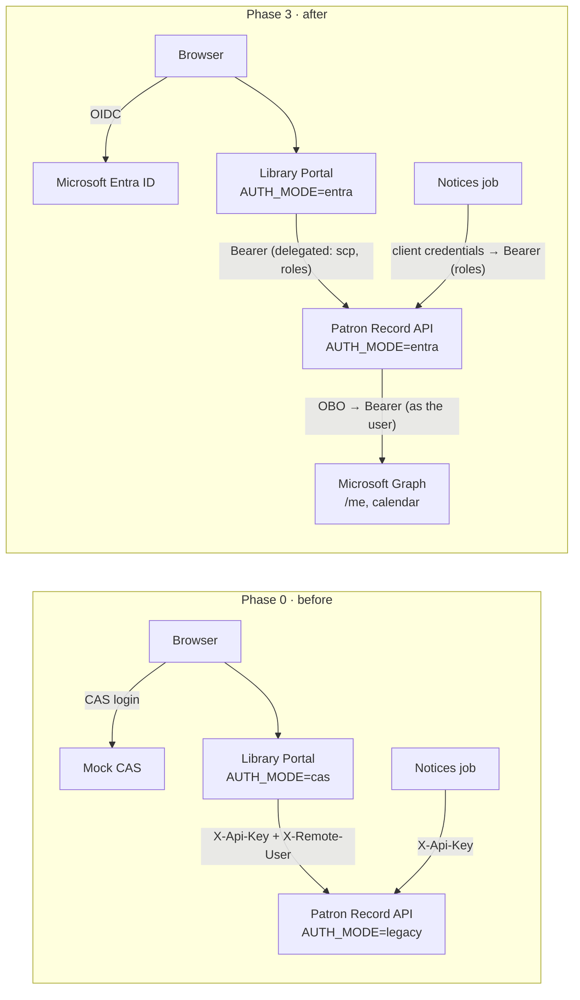

# Library Entra POC — modernizing a Ruby on Rails application to Microsoft Entra ID

This proof of concept shows how to modernize a **Ruby on Rails** application's identity: moving user sign-in from
**CAS** to **Microsoft Entra ID**, and its common **service-to-service calls** from shared API keys to **Entra
tokens**. It does this one phase at a time, with no outage and a rollback at every step.

It is a working higher-education sample (a university library), but the patterns apply to any Rails estate:

| Call | Before | After | Pattern |
|---|---|---|---|
| **User → web app** (sign-in) | CAS 3.0 ticket validation | OpenID Connect, authorization code flow | Playbook 1, AUTH-1…7 |
| **Web app → API, for the user** | API key + `X-Remote-User` header that the API must trust | The user's own access token (`scp`, `roles`) | API-1, API-2, API-8 |
| **API → downstream API, as the user** | Not possible: the API never has the user's identity | **On-Behalf-Of (OBO)** exchange to Microsoft Graph | API-3, API-4, API-6 |
| **Background job → API** (no user) | API key | **Client credentials** with an application permission (app role) | API-5 |

The application:

- **Library Portal** (Rails 8 web app): signs in with CAS today, Entra OpenID Connect after.
- **Patron Record API** (Rails 8 API, the existing back end): API key today, Entra token validation after. It also
  becomes an **OBO middle tier** for new capabilities.
- **Microsoft Graph integration** (new): "Add due dates to my Outlook calendar", written as the patron through OBO.
  There is also a licence-free **OBO check** (Graph `/me`) for tenants whose users have no mailbox.
- **Overdue-notices job** (plain Ruby): API key today, client credentials after.
- **Mock CAS server**: the "before" identity provider, so the starting state runs anywhere.

## Outcomes: the playbooks

The code is the worked example; the reusable result is the playbooks.

| Outcome | Document |
|---|---|
| **Discovery:** what has to change in a given application, from a code scan, customer questions and logs | [docs/00-discovery-playbook.md](docs/00-discovery-playbook.md) |
| Procedures and patterns to upgrade **authentication** to Entra | [docs/01-auth-upgrade-playbook.md](docs/01-auth-upgrade-playbook.md) |
| Procedures and patterns to upgrade **API integration** with OBO and client credentials | [docs/02-api-integration-playbook.md](docs/02-api-integration-playbook.md) |
| **Rails code changes**: every code and dependency change, with the actual code, for Ruby developers | [docs/03-rails-code-changes.md](docs/03-rails-code-changes.md) |

## Architecture



The tokens in the "after" state, and what stays the same across them:

| Token | Issued to | `aud` | Carries | Used for |
|---|---|---|---|---|
| ID token | Portal, at sign-in | Portal | Who signed in | The portal's session; never sent anywhere |
| Access token | Portal, at sign-in (refreshed server-side) | Patron API | `scp` `Patron.Read Patron.Manage`, the user's `roles` | Portal → API calls |
| OBO token | Patron API, in exchange for the access token | Microsoft Graph | Graph `scp`, **the same user (`oid`)** | API → Graph, as the user |
| App token | Notices job (client credentials) | Patron API | `roles: Notices.Read.All`, `idtyp: app` | Job → API, no user |

In Phase 2 the portal shows the first three side by side: the ID token card on Home, **Show the access token sent to
the API**, and **Check On-Behalf-Of with Microsoft Graph**, which lines up the claims that change from hop to hop
(`aud`, `azp`/`appid`, `scp`) against the ones that must not (`oid`, `tid`, username).

On Azure everything runs in one Container Apps environment. The portal and mock CAS have public ingress; the Patron
API is **internal only**. Secrets are **Container Apps secrets** passed in by `deploy.sh`. The apps pull images with a
**user-assigned managed identity**, which can also act as a federated credential (pattern API-7). Images are in
**Azure Container Registry**, and the notices job is a scheduled **Container Apps Job**.

## Migration phases

The same images run every phase; only settings change.

| Phase | Portal (`PORTAL_AUTH_MODE`) | Patron API (`PATRON_API_AUTH_MODE`) | Notices job (`JOB_AUTH_MODE`) | Azure command |
|---|---|---|---|---|
| **0** Before | CAS (`cas`) | API key only (`legacy`) | API key (`legacy`) | `./infra/azure/deploy.sh 0` |
| **1** Dual-accept | CAS (`cas`) | API key **or** Entra token (`both`) | API key (`legacy`) | `./infra/azure/deploy.sh 1` |
| **2** Entra sign-in + OBO | Entra OIDC (`entra`) | `both` | client credentials (`entra`) | `./infra/azure/deploy.sh 2` |
| **3** Key retired | Entra OIDC (`entra`) | Entra only (`entra`) | client credentials (`entra`) | `./infra/azure/deploy.sh 3` |

Rollback is the previous row's settings. During the dual-accept window the API logs one line per request with
`authenticated_via` (`legacy` / `delegated` / `app`). Retire the key (Phase 3) once no `legacy` lines remain.

## Software builds and libraries

Versions below are the ones this POC was built and tested with (lockfiles in each app, resolved 2026-11-05).

**Runtime and frameworks** (all three services build from `ruby:3.3-slim`)

| Component | Version | Used by |
|---|---|---|
| Ruby | 3.3.13 | All services and the notices job |
| Bundler | 2.5.22 | All services |
| Ruby on Rails | 8.0.5.2 | Portal (full stack), Patron API (`api_only`) |
| Puma | 8.0.2 (portal, API), 6.6.1 (mock CAS) | Web servers |
| Rack / rackup | 3.2.8 / 2.3.1 | All services; the mock CAS is a bare Rack app |
| Bootsnap | 1.26.1 | Portal, API |

**Identity libraries**

| Library | Version | Used by | Purpose |
|---|---|---|---|
| `omniauth` | 2.3.1 | Portal | Sign-in middleware |
| `omniauth-entra-id` | 3.1.1 | Portal | Entra ID OpenID Connect strategy (subclassed in [omniauth.rb](portal/config/initializers/omniauth.rb) for step-up claims and the ID token view) |
| `omniauth-oauth2` / `oauth2` | 1.10.0 / 2.1.0 | Portal (transitive) | Authorization code redemption |
| `omniauth-rails_csrf_protection` | 1.0.2 | Portal | POST-only, CSRF-protected sign-in request |
| `jwt` | 3.3.0 | Portal, Patron API | Token validation (API) and ID token claim checks (OmniAuth) |
| `faraday` | 2.15.1 | Portal (transitive) | HTTP client under `oauth2` |
| `json` | 2.21.2, pinned `~> 2.7` | Portal | json 3.x breaks ActiveSupport 8.0's `to_json`; see Playbook 1, Common errors |
| `entra_auth` (in this repo) | 0.1.0 | Portal, Patron API, job | Shared token toolkit: OBO, client credentials, refresh, token validation (JWKS), claims challenges, managed-identity federated credential. Standard library plus `jwt` |
| `rexml` | 3.4.4 | Portal | CAS 3.0 XML responses ("before" state) |
| `minitest` | 5.27.0 | Tests | Framework-free unit tests |

The Dockerfiles install from each `Gemfile`, not the lockfile, so a new gem release can change a build. The
committed `Gemfile.lock` files record the tested set. That is how `json` 3.x arrived between phases; pinning or
installing from the lockfile prevents it.

**Microsoft identity platform and APIs**

| Item | Version |
|---|---|
| Entra endpoints | Microsoft identity platform **v2.0** (`/oauth2/v2.0/authorize`, `/token`, `/logout`) |
| Flows | OIDC authorization code (confidential client), refresh token, OAuth 2.0 **On-Behalf-Of** (`jwt-bearer` grant), **client credentials** |
| Access tokens for the Patron API | v2 (`requestedAccessTokenVersion: 2`) |
| Microsoft Graph | v1.0 (`/me`, `/me/events`) |

**Tooling and infrastructure**

| Tool | Version tested | Used for |
|---|---|---|
| Docker / Docker Compose | Compose 5.6.1 | Local stack |
| Azure CLI | 2.90.0 | Entra setup scripts, deployment |
| Bicep | 0.45.15 | [infra/azure/main.bicep](infra/azure/main.bicep) |
| Python | 3.x (3.14 tested) | Smoke test, discovery scanner, helper code in the shell scripts |
| Azure resources | Container Apps, Container Apps Jobs and managed environments `2024-03-01`; Container Registry `2023-07-01`; user-assigned managed identity `2023-01-31`; Log Analytics `2023-09-01` | Hosting |

## Entra configuration

[`infra/entra/setup-app-registrations.sh`](infra/entra/setup-app-registrations.sh) creates three app registrations
with Azure CLI and Microsoft Graph, grants admin consent, and writes the IDs and secrets into `.env`:

| Registration | Kind | Key settings |
|---|---|---|
| `<prefix>-portal` | Confidential web client | Single tenant; web redirect URI `…/auth/entra_id/callback`; implicit grant off; delegated permissions `openid profile email offline_access` + `Patron.Read`, `Patron.Manage`; admin consent |
| `<prefix>-patron-api` | Resource API and OBO client | App ID URI `api://<id>`; v2 access tokens; scopes `Patron.Read` (user) and `Patron.Manage` (admin); user app roles Student, Faculty, Staff, Librarian, Alumni; application role `Notices.Read.All`; optional claim `idtyp`; portal as known client; delegated Graph `User.Read`, `Calendars.ReadWrite` with admin consent (needed for OBO) |
| `<prefix>-notices-job` | Daemon | Application permission `Notices.Read.All` on the Patron API, granted by admin |

All three use client secrets in the POC (production: certificates or federated credentials, API-7). Playbook 1
Step C has the checklist, and how to verify the result in the directory rather than trusting the script output.

## Prerequisites

| To run | You need |
|---|---|
| Phase 0 locally | Docker with Compose v2, bash, Python 3. No local Ruby: everything runs in the images. On Windows, use WSL |
| Phases 1–3 (local or Azure) | An **Entra tenant where you can create app registrations and grant admin consent** (Global Administrator, or Application Administrator + Privileged Role Administrator), and the Azure CLI signed in to it. Use a test tenant, not your organization's production tenant (Playbook 1 §2) |
| Azure | An Azure subscription where you are Owner (or Contributor + User Access Administrator), the Azure CLI with the `containerapp` extension (`az extension add --name containerapp`), and Python 3. **Azure Cloud Shell** has all of these |

Optional: an Exchange Online mailbox for the calendar demo (the OBO check works without one), and Entra ID P1 for
step-up MFA.

```bash
git clone <this repository's URL> library-entra-poc
cd library-entra-poc
```

## Run it locally (Docker)

```bash
cp .env.example .env
docker compose up -d --build --wait   # phase 0: portal http://localhost:3000, mock CAS on :8081
docker compose run --rm notices       # the notices job
./tools/check.sh                      # unit tests in the images + smoke test for the current phase
```

Sign in as `jstudent`, `mfaculty`, `llibrarian` or `aalumni` (password `password`). The footer shows the phase.

For phases 1–3, run the Entra setup script once (it writes `.env`; the local redirect URI is registered for you):

```bash
CREATE_TEST_USERS=true ASSIGN_ROLES_TO_ME=Student,Librarian ./infra/entra/setup-app-registrations.sh
```

Then switch phases by editing the three `*_AUTH_MODE` values in `.env` (see the phase table) and restarting:

```bash
docker compose up -d --wait   # add --build after code changes
./tools/check.sh              # infers the phase from .env
```

## Run it in Azure

Images are built in Azure Container Registry, so no local Docker is needed.

```bash
cp .env.example .env            # set RG / LOCATION / PREFIX if you like
az login
./infra/azure/deploy.sh 0       # the CAS "before" state; no Entra configuration needed
```

The script prints the portal and mock CAS URLs. Then create the Entra app registrations (as above) and move through
the phases:

```bash
./infra/azure/deploy.sh 1               # API accepts both; rebuilds images from the current code
SKIP_BUILD=1 ./infra/azure/deploy.sh 2  # portal on Entra, OBO to Graph, job on client credentials
SKIP_BUILD=1 ./infra/azure/deploy.sh 3  # API key retired

az containerapp job start -g rg-library-entra-poc -n libpoc-notices   # run the notices job now
```

`SKIP_BUILD=1` reuses the previous images, so only use it when the code hasn't changed since the last build. From
phase 1, `deploy.sh` adds the Azure callback URL to the portal registration. To pause without deleting, run
`az containerapp revision deactivate` per app. Clean up with `./infra/azure/destroy.sh` and
`./infra/entra/teardown.sh` (add `DELETE_TEST_USERS=true` to remove the test users).

**Optional step-up MFA for fines** (needs Entra ID P1): create a Conditional Access authentication context `c1` with a
policy requiring MFA, set `FINES_AUTH_CONTEXT=c1` in `.env`, and redeploy (Playbook 1, AUTH-7).

## Demo script (10 minutes)

1. **Phase 0.** Sign in through CAS as `jstudent`. Home shows "API saw this call as `legacy`". Loans → *Add due dates
   to my Outlook calendar* → the API explains it can't: it only has a NetID in a header.
2. **Phase 1.** Nothing visible changes for users; that's the point of the dual-accept window. Show the API log
   lines labelled `legacy`, and call the API with the job's client-credentials token (Playbook 2 §5).
3. **Phase 2.** Sign in with Microsoft.
   - **Home:** "`delegated` from &lt;portal client ID&gt;", the linked Entra object ID, and the **ID token** (`aud` = portal).
   - **Show the access token sent to the API:** `aud` = Patron API, `scp`, `roles`, `azp` = portal. The API reads it
     back; the portal never decodes access tokens.
   - **Check On-Behalf-Of with Microsoft Graph:** the API exchanges that token for a Graph token and calls `/me`. Graph
     names the same user, and the correlation table shows `oid` identical across all tokens while `aud`, `azp` and
     `scp` change at each hop. Needs no licence.
   - **Loans → calendar:** with an Exchange Online mailbox, events appear in Outlook, created by the API **as the
     user**. Without one, a readable "no Exchange Online mailbox" message.
4. As a user with the Alumni role, e-resources are refused by the API. As a Librarian: Staff → look up `jstudent` →
   waive a fine; the API audit log records the librarian's `oid`, not a service account.
5. Run the notices job: the log says it used **client credentials**, and the API logs the call as `app`.
6. **Phase 3.** The API key stops working; everything still runs on Entra tokens.

## Repository map

Every place the code changes for Entra carries an `ENTRA MIGRATION (phase N, <pattern>)` comment, where the pattern ID
(AUTH-n, API-n) points to the playbooks. List them all with `grep -rn "ENTRA MIGRATION" portal patron-api gems`.

```
portal/                                Library Portal (Rails 8)
  lib/cas_client.rb                      BEFORE: CAS 3.0 client
  config/initializers/omniauth.rb        AFTER: Entra OIDC (OmniAuth), step-up claims, ID token capture
  app/models/identity.rb                 attribute-mapping seam (CAS attributes / OIDC claims)
  lib/patron_api_client.rb               API client: legacy credentials vs bearer token
  app/services/entra_token_store.rb      server-side tokens + refresh
  app/models/token_correlation.rb        demo: lines up ID, access and OBO token claims
  app/views/home/                        Home (ID token), access token view, Graph OBO check
patron-api/                            Patron Record API (Rails 8, API only)
  app/services/authenticator.rb          legacy | both | entra
  app/controllers/application_controller.rb  per-request auth log, scope/role checks, OBO helper
  app/controllers/me_controller.rb       /me, /me/token (access token as received), /me/graph-profile (OBO check)
  app/controllers/loans_controller.rb    OBO → Graph calendar
  app/controllers/notices_controller.rb  app-only endpoint for the job
  app/services/graph_*.rb                Graph calls (calendar, profile) and error handling
  lib/overdue_notices_job.rb             client credentials job (bin/overdue_notices)
gems/entra_auth/                       shared token toolkit: OBO, client credentials, refresh,
                                       claims challenges, JWKS, token validation, managed-identity FIC
mock-cas/                              minimal CAS server (Ruby + Rack)
infra/entra/                           app registrations (az CLI), teardown
infra/azure/                           Bicep (Container Apps, ACR, identity) + deploy/destroy
tools/check.sh                         every check: unit tests in the images, scanner tests, smoke test
tools/smoke/                           end-to-end smoke test per phase
tools/discovery/                       scan.py: finds CAS and shared-secret API dependencies in any app repo
docs/                                  the playbooks (0 discovery, 1 sign-in, 2 API integration)
```

## Tests

**`./tools/check.sh` runs everything, with no local Ruby needed.** It rebuilds the local stack (skip with
`SKIP_BUILD=1`), runs every unit test inside the images against the code on disk, runs the discovery scanner's
tests, then runs the smoke test for the phase in `.env`. Run it after every change.

| Suite | Tests | Covers |
|---|---|---|
| `gems/entra_auth` | 19 | OBO, client credentials, refresh, claims challenges, JWKS, token validation (audience, issuer, expiry, tenant, algorithm) |
| `patron-api` | 22 | `legacy`/`both`/`entra` authentication, NetID ↔ oid crosswalk, Graph calendar and profile calls, Graph errors, the job |
| `portal` | 17 | CAS round trip, identity mapping, API client and error mapping, token refresh and step-up, token correlation |
| `mock-cas` | 5 | CAS protocol behaviour |
| discovery scanner | — | `tools/discovery/test_scan.py` |

The **smoke test** ([tools/smoke/smoke_test.py](tools/smoke/smoke_test.py)) signs in through CAS as each demo user,
exercises every page and form, and calls the API directly. Expected results follow the validation tables in
Playbook 1 §5 and Playbook 2 §5.

```bash
python3 tools/smoke/smoke_test.py --phase 0 --mutate                     # local; --mutate also waives a fine
python3 tools/smoke/smoke_test.py --phase 0 --portal https://<portal-fqdn> --no-api   # Azure (API is internal-only)
```

In phases 2–3 it only checks that sign-in starts at Entra, because signing in to Microsoft is interactive. The
user-facing checks are done by hand (Playbook 1 §5).

## Status and limits of this POC

- **Phase 0, local (2026-11-04):** images build, all services boot, and the demo works end to end for all four
  users, including the calendar refusal, role refusals, fine waiver with audit log, notices job and API key checks.
  Re-verified 2026-11-05 after all later changes: smoke test 29/29.
- **Phase 0, Azure (2026-11-04):** `deploy.sh 0` in a sandbox subscription whose Azure Policy forbids public Key Vaults. The smoke test passes
  against the Azure portal; the Patron API is not reachable from the internet; HTTP redirects to HTTPS; the notices
  job succeeds; Log Analytics shows the audit lines. Azure is **still on Phase 0** with 2026-11-04 images; phases 1–3
  have not been deployed there.
- **Entra setup (2026-11-05):** run in a dedicated test tenant as Global Administrator, and verified in the directory:
  v2 tokens, scopes, app roles, known client, admin consent for all delegated grants, and every role assignment.
- **Phase 1, local (2026-11-05):** CAS users and API-key callers unchanged. A real client-credentials token from the
  job is accepted. A tampered token, a token for Graph, and an app token without the role are all refused. The
  per-request `authenticated_via` log line was added here.
- **Phase 2, local (2026-11-05):** switched on; the sign-in page redirects to Entra; the notices job runs on client
  credentials and the API logs it as `app`; smoke test 14/14. The first switch-over failed with an HTTP 500 on the
  sign-in page (`json` 3.x, now pinned). The ID token, access token and OBO check pages are unit-tested and rendered,
  but **a full browser sign-in with real tokens has not yet been recorded**.
- **Phase 3:** not yet run.
- **Tenant constraints in the test environment:** test users have no Microsoft 365 licence, so Graph calendar
  writes fail with "no mailbox" (the OBO check covers OBO without one). The tenant's existing Conditional Access
  required MFA for every user except the administrator and blocked MFA registration, so the test users couldn't
  complete sign-in; the administrator account, given Student and Librarian roles (`ASSIGN_ROLES_TO_ME`), was used for
  Entra demos. Check your own tenant's Conditional Access before planning test users. Step-up MFA (AUTH-7) needs
  Entra ID P1 and is not demonstrated.
- **Demo shortcuts, all marked in code:** in-memory patron data, sessions and token caches (one replica each; use a
  database and Redis to scale); mock CAS with plain-text passwords; client secrets rather than federated
  credentials; tokens decoded for display on the demo pages only.

## License

[MIT](LICENSE). This is a sample, not a supported product: review it, and replace the demo shortcuts above, before
using any of it in production.
