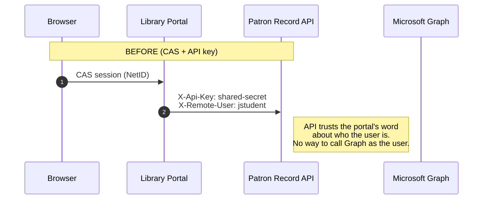

# Playbook 2 — Upgrading API integration to Entra tokens: On-Behalf-Of and client credentials

**Outcome:** a repeatable procedure, and the patterns behind it, for replacing API keys and trusted username
headers with Entra access tokens: delegated tokens from the web app, **On-Behalf-Of (OBO)** when an API calls another
API as the user, and **client credentials** when no user is present.
The Patron Record API, the Library Portal and the overdue-notices job in this repo are the worked example.

---

## 1. Before and after



```mermaid
sequenceDiagram
    autonumber
    participant B as Browser
    participant E as Microsoft Entra ID
    participant P as Library Portal
    participant A as Patron Record API
    participant G as Microsoft Graph
    participant J as Notices job
    Note over B,G: AFTER (Entra)
    B->>E: OIDC sign-in (scopes: openid … Patron.Read)
    E-->>P: ID token + access token (aud = Patron API) + refresh token
    P->>A: Authorization: Bearer <token, aud = Patron API>
    A->>A: Validate signature, iss, aud, exp, tid; check scp / roles
    A->>E: OBO: grant_type=jwt-bearer, assertion=<incoming token>, scope=Graph
    E-->>A: access token (aud = Graph, still the user)
    A->>G: POST /me/events
    J->>E: client_credentials, scope=api://patron-api/.default
    E-->>J: app-only token (roles = Notices.Read.All)
    J->>A: GET /notices/overdue
```

| | Before | After |
|---|---|---|
| Portal → Patron API | Shared API key + `X-Remote-User` header | User's access token (delegated, `scp`) |
| Who decides the user's identity at the API | The caller, by asserting a header | Entra, by signing the token |
| Patron API → Graph | Not possible | OBO token, as the user |
| Batch job → Patron API | Same shared API key | Client credentials, app role `Notices.Read.All` |
| Revoking one caller | Rotate the key for everyone | Remove that app's permission or disable its service principal |
| Audit | "legacy-api-key did X for jstudent" | `oid` of the user **and** `azp` of the calling app |
| Switch in this repo | `AUTH_MODE=legacy` | `AUTH_MODE=both` → `entra` |

---

## 2. Choose the right flow

| Situation | Flow | In this repo |
|---|---|---|
| A signed-in user's web app calls your API | **Delegated token** obtained at sign-in (or later via refresh) | Portal → Patron API |
| Your API must call another API **as that user** | **On-Behalf-Of** | Patron API → Graph calendar |
| No user: scheduled job, sync, integration | **Client credentials** with an app role | Notices job → Patron API |
| Single-page app or mobile app calls your API | Delegated token via auth code + PKCE (public client) | not shown |

Anti-patterns to remove during the migration:

- Passing the **user's token through** to a downstream API (wrong audience; the downstream must reject it).
- Calling a downstream API with **client credentials while acting for a user** (loses the user's permissions and the audit trail).
- An **API key plus a username header** (the caller can claim to be anyone).
- One app registration shared by several apps.

---

## 3. Procedure

### Step A — Inventory callers and credentials

For each API, list every caller, how it authenticates today (API key, basic auth, CAS proxy ticket, IP allowlist),
whether it acts **for a user** or **as itself**, and which operations it uses. That list decides which caller gets
OBO/delegated tokens and which gets client credentials, and which scopes and app roles the API needs.

The scanner's `SHARED-SECRET`, `HTTP-CLIENT`, `NETWORK-TRUST` and `JOBS` findings give the callers that are visible
in code; API access logs and the API owners give the rest ([Playbook 0](00-discovery-playbook.md), Steps 1–3 and
inventory section F).

### Step B — Register the API

([`setup-app-registrations.sh`](../infra/entra/setup-app-registrations.sh), step 2)

- [ ] Application ID URI `api://<client-id>`.
- [ ] **`requestedAccessTokenVersion: 2`** ("accessTokenAcceptedVersion" in the manifest). Without it tokens carry the v1
      issuer `https://sts.windows.net/<tenant>/` and validation against the v2 issuer fails.
- [ ] **Delegated scopes** for what users do through client apps: `Patron.Read` (user-consentable),
      `Patron.Manage` (admin-consent only).
- [ ] **App roles for users** (`Student`, `Faculty`, `Staff`, `Librarian`, `Alumni`) and an **application app role**
      for daemons (`Notices.Read.All`, `allowedMemberTypes: ["Application"]`).
- [ ] Optional claim `idtyp` on access tokens, so app-only tokens are labelled `idtyp: app`.
- [ ] `knownClientApplications: [<portal client id>]` so a user's single consent covers the portal **and** the API's
      downstream Graph permissions (combined consent). Admin consent makes this moot but it's the right default.
- [ ] If the API calls downstream APIs with OBO: the API is also a **confidential client** (its own secret or
      federated credential) with **delegated** permissions to the downstream (here Graph `Calendars.ReadWrite`, `User.Read`),
      and **admin consent** for them. There's no interactive consent screen in the middle of an OBO call.

### Step C — Validate every incoming token (pattern API-1)

[`EntraAuth::TokenValidator`](../gems/entra_auth/lib/entra_auth/token_validator.rb):

1. Signature: RS256 only, keys from `https://login.microsoftonline.com/<tenant>/discovery/v2.0/keys`,
   cached, refreshed on unknown `kid` but rate-limited ([`JwksProvider`](../gems/entra_auth/lib/entra_auth/jwks_provider.rb)).
2. `iss` = `https://login.microsoftonline.com/<tenant>/v2.0`.
3. `aud` = the API's client ID (or `api://<client-id>`). **Reject tokens for any other audience**, including Graph tokens.
4. `exp`, `nbf`, `iat` with a small clock skew.
5. `tid` = your tenant.

Then authorize ([`ApplicationController`](../patron-api/app/controllers/application_controller.rb)):

- **Delegated** token (has `scp`): require the scope for the operation, then the user's app role where needed.
- **App-only** token (no `scp`, `idtyp=app`): require the application role. Never treat an app-only token as a user.

### Step D — Open a dual-accept window (pattern API-2)

Deploy the API with `AUTH_MODE=both` ([`Authenticator`](../patron-api/app/services/authenticator.rb)): API keys and
Entra tokens both work, and each request is logged with `authenticated_via` (`legacy` / `delegated` / `app`).
Watch the logs until no `legacy` calls remain. In Azure: `./infra/azure/deploy.sh 1`.

Logging every request is the step most often missed. Audit lines on a few sensitive actions are not enough: the
reads are where forgotten callers hide. Log one line per request in the authentication hook, with the actor and
the route ([`ApplicationController#authenticate!`](../patron-api/app/controllers/application_controller.rb)):

```
{"authenticated_via":"legacy","actor":{"kind":"legacy","netid":"jstudent","app_id":"legacy-api-key"},"request":"GET /api/v1/me"}
{"authenticated_via":"app","actor":{"kind":"app","oid":"…","app_id":"<job client ID>"},"request":"GET /api/v1/notices/overdue"}
```

Count them by type to see how far along the move is (locally:
`docker compose logs patron-api | grep -o '"authenticated_via":"[a-z]*"' | sort | uniq -c`). Group the `legacy` lines
by `request` to find which callers still need to move.


### Step E — Move each caller

**Interactive web app (portal):** request the API's scopes during sign-in, keep the access and refresh tokens in the
server-side session, send `Authorization: Bearer`. The only code that changes is the credential object passed to the
API client ([`PatronApiClient::BearerCredentials`](../portal/lib/patron_api_client.rb),
[`ApplicationController#api_credentials`](../portal/app/controllers/application_controller.rb)).

**Batch job:** give it its own app registration, assign the application role, request
`api://<patron-api-client-id>/.default` with `grant_type=client_credentials`
([`OverdueNoticesJob`](../patron-api/lib/overdue_notices_job.rb),
[`ClientCredentialsClient`](../gems/entra_auth/lib/entra_auth/client_credentials_client.rb)).

In Azure: `./infra/azure/deploy.sh 2`.

### Step F — Add downstream calls with OBO (pattern API-3)

In the middle-tier API ([`LoansController#reminders`](../patron-api/app/controllers/loans_controller.rb)):

```ruby
graph_token = AppServices.obo.acquire(
  user_assertion: principal.assertion,  # the raw incoming access token (aud = this API)
  scope: "https://graph.microsoft.com/.default",
  user_key: principal.oid               # cache per user + scope
)
```

What goes over the wire ([`OboClient`](../gems/entra_auth/lib/entra_auth/obo_client.rb)):

```
POST https://login.microsoftonline.com/<tenant>/oauth2/v2.0/token
grant_type=urn:ietf:params:oauth:grant-type:jwt-bearer
client_id=<patron-api client id>
client_secret=<patron-api secret>          (or client_assertion, see API-7)
assertion=<incoming access token>
scope=https://graph.microsoft.com/.default
requested_token_use=on_behalf_of
```

Rules: one downstream **resource** per OBO request; never OBO with an ID token; never cache across users;
handle claims challenges (API-4).

### Step G — Retire the API key

Set `AUTH_MODE=entra` (`./infra/azure/deploy.sh 3`), confirm API-key calls now get `401` with
"API keys are no longer accepted", then delete the key from the secret store (here, the Container Apps secrets) and every client's configuration.

### Step H — Harden for production

- Replace client secrets with **federated credentials on a managed identity** (API-7).
- Back token caches and sessions with **Redis** when running more than one replica.
- Turn on **Continuous Access Evaluation** awareness: advertise client capability `cp1` and handle `insufficient_claims`
  from Graph (the code already passes Graph claims challenges up the chain).
- Alert on `401`/`403` spikes and on any remaining `legacy` authentications.

---

## 4. Patterns

### API-1 · Validate, then authorize
- **Problem:** "it has a valid signature" is mistaken for "it's allowed".
- **Pattern:** validation (signature, issuer, audience, lifetime, tenant) is generic and lives in a shared library;
  authorization (scope, role, auth context) is per operation and lives in the API.
- **Code:** [`TokenValidator`](../gems/entra_auth/lib/entra_auth/token_validator.rb),
  `require_scope!` / `require_role!` / `require_app_role!` in [`ApplicationController`](../patron-api/app/controllers/application_controller.rb).
- **Check:** a valid Graph token, a token from another tenant, an expired token and an `alg: none` token are all rejected
  ([tests](../gems/entra_auth/test/claims_and_validation_test.rb)).

### API-2 · Dual-accept window
- **Problem:** clients can't all switch on the same day.
- **Pattern:** the API accepts old and new credentials for a bounded period, labels every request with how it
  authenticated, and the old path is removed when the label disappears from the logs.
- **Code:** `AUTH_MODE=legacy|both|entra` in [`Authenticator`](../patron-api/app/services/authenticator.rb).

### API-3 · OBO in the middle tier
- **Problem:** the API must call Graph (or the SIS, or the bursar's API) with the user's permissions.
- **Pattern:** exchange the incoming token for a downstream token as the same user; cache per user + scope;
  grant the API delegated permissions to the downstream with admin consent.
- **Code:** [`OboClient`](../gems/entra_auth/lib/entra_auth/obo_client.rb), [`LoansController#reminders`](../patron-api/app/controllers/loans_controller.rb),
  [`GraphCalendar`](../patron-api/app/services/graph_calendar.rb).
- **Check:** the calendar event appears in the **user's** calendar, and the Graph sign-in log shows the Patron API as
  the client app acting for that user.
- **Check without a licence:** test users in a sandbox tenant usually have no Exchange Online mailbox, so the
  calendar write fails even when OBO works. Run the same exchange against Graph `GET /me`, which needs only `User.Read`
  and works for every Entra user: portal **Home → Check On-Behalf-Of with Microsoft Graph**
  ([`MeController#graph_profile`](../patron-api/app/controllers/me_controller.rb), [`GraphProfile`](../patron-api/app/services/graph_profile.rb)).
  Pass: Graph returns the signed-in user's own object ID ("Same user: Yes") and the OBO token's scopes include
  `User.Read`. An `AADSTS` error instead means the exchange itself failed (consent, secret, wrong assertion).
- **Report downstream refusals:** when Graph refuses the call, return its error code (502 `graph_error`, e.g.
  `MailboxNotEnabledForRESTAPI`) rather than letting the exception become a 500. That way "OBO worked, Graph said no"
  is distinguishable from "OBO failed".

### API-4 · Claims challenges travel back to the browser
- **Problem:** Conditional Access, authentication contexts and CAE can require the user to do something (MFA,
  re-sign-in) that only the browser-facing app can drive.
- **Pattern:** token endpoint returns `interaction_required` + `claims` → the API returns `401` with
  `WWW-Authenticate: Bearer error="insufficient_claims", claims="<base64>"` → the web app sends the user to
  `/authorize` with `claims=<json>` and retries.
- **Code:** [`TokenEndpoint`](../gems/entra_auth/lib/entra_auth/token_endpoint.rb) raises `ClaimsChallengeRequired`;
  [`ClaimsChallenge`](../gems/entra_auth/lib/entra_auth/claims_challenge.rb) builds and parses the header;
  the portal's [`step_up`](../portal/app/controllers/application_controller.rb) and the `EntraIdStepUp` strategy in the [OmniAuth initializer](../portal/config/initializers/omniauth.rb) complete the loop (claims are added per request, never to shared strategy options).

### API-5 · Daemon with client credentials and an app role
- **Problem:** a job uses a human's account or the shared API key.
- **Pattern:** its own app registration; an application app role on the target API granted by an admin;
  scope `<resource>/.default`; the API checks `roles`, not `scp`.
- **Code:** [`OverdueNoticesJob`](../patron-api/lib/overdue_notices_job.rb), [`NoticesController`](../patron-api/app/controllers/notices_controller.rb).
- **Check:** a delegated user token is refused on `/notices/overdue`; the job's token is refused on `/me`.

### API-6 · Token cache keyed by user and scope
- **Problem:** fetching a token on every request is slow and throttled; a shared cache key leaks one user's access to another.
- **Pattern:** key delegated tokens by `oid` + scope, app tokens by scope; expire a few minutes early.
- **Code:** [`TokenCache`](../gems/entra_auth/lib/entra_auth/token_cache.rb) (in-memory; swap for Redis to scale out).

### API-7 · Secretless credentials
- **Problem:** client secrets expire and leak.
- **Pattern:** in Azure, the app's user-assigned managed identity obtains a token for `api://AzureADTokenExchange`;
  the app registration trusts it through a federated identity credential; that token is sent as `client_assertion`.
- **Code:** [`ManagedIdentityAssertion`](../gems/entra_auth/lib/entra_auth/managed_identity_assertion.rb);
  enable with `ENTRA_USE_MANAGED_IDENTITY_FIC=true` (API) or `JOB_USE_MANAGED_IDENTITY_FIC=true` (job). The Bicep
  template already passes the identity's client ID as `AZURE_CLIENT_ID`.
- **Setup:**
  ```bash
  az ad app federated-credential create --id <patron-api-client-id> --parameters '{
    "name": "container-apps", "issuer": "https://login.microsoftonline.com/<tenant-id>/v2.0",
    "subject": "<appsIdentityPrincipalId output>", "audiences": ["api://AzureADTokenExchange"] }'
  ```

### API-8 · Clients treat access tokens as opaque
- **Problem:** web apps decode access tokens to read roles, then break when the token format changes or is encrypted.
- **Pattern:** the client reads its own **ID token** for who the user is and asks the API what the user may do.
- **Code:** portal roles come from `GET /api/v1/me` ([`ApplicationController#api_roles`](../portal/app/controllers/application_controller.rb)).

---

## 5. Validation test matrix

| Request | Phase 0 (`legacy`) | Phase 1 (`both`) | Phase 3 (`entra`) |
|---|---|---|---|
| Portal (CAS) → `/me` with API key | 200 | 200 | 401 "API keys are no longer accepted" |
| Portal (Entra) → `/me` with user token | 401 | 200 | 200 |
| Wrong API key | 401 | 401 | 401 |
| Graph token sent to the Patron API | 401 | 401 "Signature verification failed" | 401 (signature) |
| `/me/loans/reminders` with API key | 501 "requires the patron's own Entra token" | 501 | 401 |
| `/me/loans/reminders` with user token | – | 201, events in the user's calendar (502 `MailboxNotEnabledForRESTAPI` without a mailbox) | 201 |
| `/me/graph-profile` with API key | 501 | 501 | 401 |
| `/me/graph-profile` with user token (licence-free OBO check) | – | 200, `same_user: true` | 200 |
| `/notices/overdue` with API key, no user | 200 | 200 | 401 |
| `/notices/overdue` with job's client-credentials token | 401 | 200 | 200 |
| `/notices/overdue` with a user token | – | 403 | 403 |
| `/me/eresources` as Alumni | 403 | 403 | 403 |
| `/patrons/jstudent` as Student | 403 | 403 | 403 |
| `/me/fines` with `FINES_AUTH_CONTEXT=c1`, no MFA yet | 200 (no step-up for API keys) | 401 claims challenge (Entra callers) | 401 claims challenge |

Quick API checks (local Docker, phase 0 or 1):

```bash
curl -s localhost:3001/api/v1/me -H "X-Api-Key: $LEGACY_API_KEY" -H "X-Remote-User: jstudent"
curl -s localhost:3001/api/v1/notices/overdue -H "X-Api-Key: $LEGACY_API_KEY"
curl -si -X POST localhost:3001/api/v1/me/loans/reminders -H "X-Api-Key: $LEGACY_API_KEY" -H "X-Remote-User: jstudent"
```

Entra token checks (phase 1 or later; `set -a; . ./.env; set +a` first). Get the job's app-only token, then call the API:

```bash
TOK=$(curl -s https://login.microsoftonline.com/$ENTRA_TENANT_ID/oauth2/v2.0/token \
  -d grant_type=client_credentials -d client_id=$JOB_CLIENT_ID \
  --data-urlencode client_secret="$JOB_CLIENT_SECRET" --data-urlencode scope="$PATRON_API_APP_SCOPE" | jq -r .access_token)
curl -s localhost:3001/api/v1/notices/overdue -H "Authorization: Bearer $TOK"   # 200
curl -s localhost:3001/api/v1/me -H "Authorization: Bearer $TOK"                # 403: needs a signed-in user
```

The token should be `ver` 2.0, `aud` = the API's client ID, `roles` = `["Notices.Read.All"]`, `idtyp` = `app`.
Also check refusals: a tampered signature (401), and a client-credentials token from an app with no role, e.g. the
portal (403 "Requires an app-only token…"). A Graph token sent to your API fails the **signature** check first,
because Graph tokens can only be verified by Graph. Use the unit test with a properly signed token
(`test_rejects_wrong_audience`) to prove the **audience** check.

*Verified locally 2026-11-05 (phase 1):* all of the above, plus the 28-check smoke test (`--phase 1 --mutate`) with
CAS users and API-key callers unchanged.

---

## 6. Common errors

| Error | Meaning | Fix |
|---|---|---|
| API returns `invalid_token`, "Invalid issuer" with `sts.windows.net` | v1 tokens | Set `requestedAccessTokenVersion: 2` on the **API** registration |
| API returns `invalid_token`, "Invalid audience" | Client requested a token for another resource (often Graph) | Client must request `api://<api-client-id>/<scope>` |
| OBO `AADSTS65001` | API lacks consent for the downstream permission | Admin consent for the API's Graph permissions |
| OBO `AADSTS50013` / assertion errors | Wrong token used as the assertion (ID token, expired, or for another audience) | Pass the raw incoming access token for this API |
| OBO `AADSTS50076` / `AADSTS50079` (`interaction_required` + `claims`) | MFA or CA required for the downstream | Expected: propagate the claims challenge (API-4) |
| `AADSTS70011` invalid scope (client credentials) | Named scope instead of `.default` | Use `api://<api-client-id>/.default` |
| `AADSTS500011` resource principal not found | Application ID URI typo, or the API has no service principal | Check `identifierUris`; `az ad sp create --id <api-client-id>` |
| `AADSTS7000215` | Bad client secret | Use the secret value; check expiry |
| Job gets 403 "Requires an app-only token…" | App role not granted | Grant admin consent / app role assignment to the job's service principal |
| Graph `MailboxNotEnabledForRESTAPI` | User has no Exchange Online mailbox | License the user, or demo with a licensed account (`ASSIGN_ROLES_TO_ME`) |
